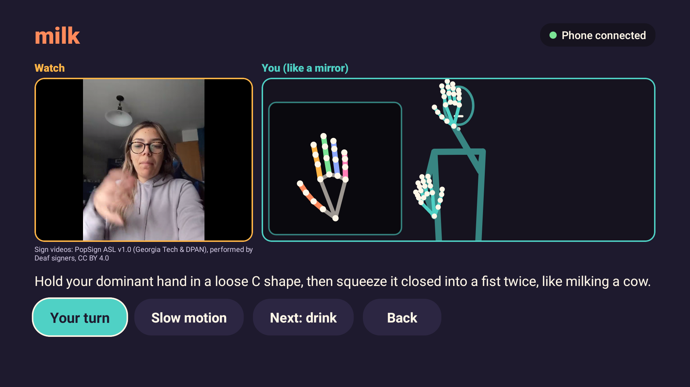
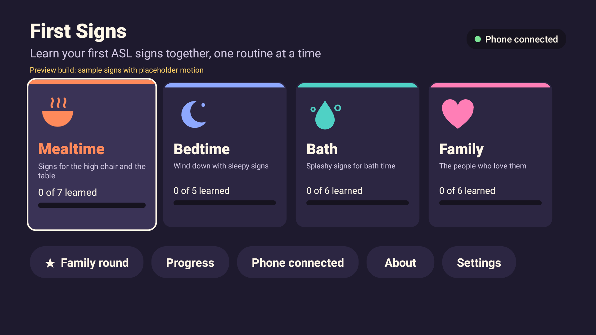
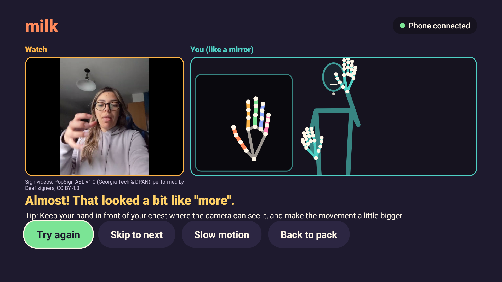
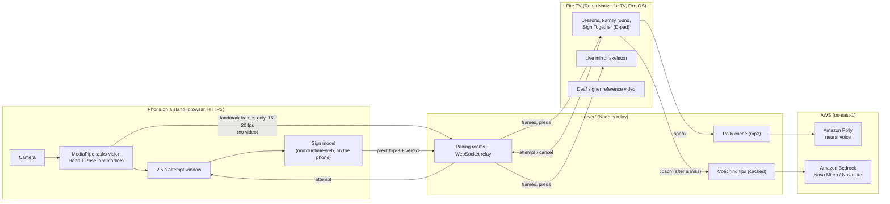

# First Signs

**Your baby's first ASL words, learned together on the living-room TV.**

First Signs is a Fire TV app that helps hearing families learn their first American Sign Language (ASL) words for a Deaf
baby or toddler. A phone on a stand is the camera. The TV shows a real Deaf signer making the sign, counts the family
in, watches them sign it, and says whether they got it, with a short coaching tip when they didn't. The words come in
routine packs (Mealtime, Bedtime, Bath time, Family), so the signs get used in daily life.

First Signs is a learning tool for hearing families. It does not translate or interpret ASL, and it is not a substitute
for a Deaf teacher.

Built for the Amazon "Build, Ship, Shape" hackathon: Fire TV track, plus the AWS Builder and Open Source mini-challenges.



## Why this exists

- Babies understand common words from about 6 months.
- 9 in 10 children born deaf have hearing parents.
- Early access to language matters: signed or spoken, the earlier the better.

So most Deaf babies depend on parents who are just starting to learn a sign language. Those parents have books, videos
and phone apps, but none of them can tell you that *your* sign is wrong. Only a human teacher can do that today.

### Why the TV, and not another phone app

| On a phone app | First Signs on the TV |
|---|---|
| You hold the phone, so you sign one-handed, even though many signs need both hands. The Deaf signer in our own reference videos held their phone while recording, and about 10 of the 40 clips are one-handed as a result. | The phone sits on a stand as a camera only, so **both hands are free**. |
| The reference sign is tiny. | The reference is **life-size** at couch distance, like a real class. |
| One person at a time; a family crowding round can't see. | The **feedback is big enough for the whole family**, and people take turns in the Family round, or sign side by side in Sign Together. |

The result is real feedback on real, two-handed signing, done together.

## What it does

- **Pair:** the TV shows a QR code and a 4-digit code. Scan it with a phone, put the phone on a stand, and it becomes the camera.
- **Lessons:** 40 signs in 4 packs. For each sign you watch a short clip of a Deaf signer (with a slow-motion option),
  then press **Your turn**. The TV counts you in (3-2-1), records a 2.5-second window, and shows the result: a
  celebration if you got it, or "looked a bit like X" plus a coaching tip if you didn't. Each sign earns 0-3 stars.
- **Family round:** pick the players (Mum, Dad, Grandma...), a pack and a number of turns. Players take turns on random
  signs; a right answer scores 1, or 2 on a streak of 3 or more. Ends with a scoreboard.
- **Sign Together:** two people stand side by side in one camera frame. Each gets their own mirror pane and verdict.
- **Progress, About, Settings:** progress is stored on the TV. About credits the Deaf signers and points to Deaf-led classes.
- **Remote only:** everything is driven with the D-pad, OK and Back. Spoken prompts (Amazon Polly) are also shown as text.

| Pair | Home | Result |
|---|---|---|
|  |  |  |

## How it works



1. **Phone (`phone/`)**: a plain web page. It runs MediaPipe Hand and Pose landmarkers on the phone and streams
   landmark frames (hands and upper-body pose points, never the face mesh) to the server. When the TV asks for an attempt, the phone
   counts down, records a window, runs the sign model **on the phone** and sends back the top-3 guesses and a verdict.
2. **Server (`server/`)**: a small Node.js relay. It pairs the TV and phone with a 4-digit room code, relays
   messages, and makes the AWS calls:
   - **Amazon Polly** (`SynthesizeSpeech`, neural engine, voice Danielle) speaks prompts like "Your turn. Sign milk."
     Every phrase is cached on disk by the SHA-1 of voice and text, so it is synthesized once.
   - **Amazon Bedrock** (Converse API, Amazon Nova Micro, falling back to Nova Lite) writes a coaching tip of two
     sentences or fewer after a miss. The prompt contains only the checked description of the target sign (and of the
     sign it was confused with), and tells the model not to add anything. Descriptions marked unverified are never
     sent. Tips are cached per (sign, confused-with, attempt bucket).
   - If AWS is unavailable, the TV shows the prompt as text and the server returns a canned tip built from the same
     verified description. The app keeps working.
3. **TV (`tv/`)**: React Native for TV (`react-native-tvos` 0.81) on Expo SDK 54, structured like Amazon's
   [react-native-multi-tv-app-sample](https://github.com/AmazonAppDev/react-native-multi-tv-app-sample). It plays the
   Deaf signer's clip, draws the family's live skeleton as a mirror, and runs the lesson and game flow.
4. **Model (`model/`)**: a ~995k-parameter classifier (4.0 MB ONNX) trained on landmarks from Deaf signers in Google's
   GISLR dataset. The exact message formats every component follows are in [`PROTOCOL.md`](PROTOCOL.md).

**The verdict.** An attempt counts as correct when the target sign is in the top 3, its probability is at least 0.25,
and at least one hand was visible in at least 40% of the window. Before the softmax, the model's outputs are limited to
the signs in the current pack. The thresholds live in `model/export/signs.json` and can be tuned without code changes.

## Accuracy

### Held-out Deaf signers (measured)

The shipped model is trained on all 21 signers in GISLR's training set. It is tested on GISLR's **rerun set**,
Kaggle's public release of the competition's hidden test data: **10 different Deaf signers, 6,461 clips of our 40
signs**, none of whom are in the training data. Numbers are from [`model/export/metrics.json`](model/export/metrics.json).

"In-pack" is how the app uses the model: only the current pack's signs are candidates. "Phone-sim" makes the clips look
more like the phone's window: every 2nd frame (15 fps), idle holds before and after the sign, and 10% of hand
detections dropped.

| Pack | Signs | Top-1 | Top-3 | Top-1 (phone-sim) | Top-3 (phone-sim) |
|---|---|---|---|---|---|
| Mealtime | 10 | 97.6% | 98.4% | 96.0% | 97.3% |
| Bedtime | 10 | 94.5% | 97.6% | 91.8% | 95.8% |
| Bath time | 8 | 93.4% | 97.0% | 90.6% | 95.4% |
| Family | 12 | 92.3% | 97.6% | 89.8% | 95.9% |
| **All packs** | 40 | **94.4%** | **97.7%** | **92.0%** | **96.1%** |

- **All 40 signs at once** (no pack limit): top-1 90.9%, top-3 95.5% (phone-sim: 87.8% and 92.9%).
- **Spread across the 10 unseen signers:** 40-way top-1 ranges from 78.6% to 96.9%.
- **Cross-validation inside the training set** (5 folds, split by signer, 15,204 clips): in-pack top-1 89.5%, top-3 95.5%.
- **The verdict at the default thresholds:** when the target sign is made, it is accepted 81.5% of the time. Many GISLR
  clips are cropped so hands show in under 40% of frames; without that hand gate the accept rate is 94.6% (91.8%
  phone-sim). When a different sign from the same pack is made, it is wrongly accepted 0.3-0.7% of the time.
- **Main confusions:** shower is the weakest sign (77% top-1; it is mistaken for dry or clean). dad/grandpa and
  mom/grandma differ only by a forward hop and are confused 12-13% of the time; top-3 still holds them at 97% or more.

Full per-sign and per-signer tables, the confusion list and how the 40 signs were chosen are in
[`model/README.md`](model/README.md).

### Live, on the phone camera, with hearing learners

> **TODO: being measured.** The numbers above come from GISLR's own recordings of fluent Deaf signers. They are not a
> measurement of First Signs' live phone camera, at couch distance, in home lighting, with hearing learners, who will
> sign less cleanly. This section will report that measurement (attempts, signers, signs, accept rate), whatever it shows.
>
> | Setup | Attempts | Signers | Correct-sign accept rate | Wrong-sign accept rate |
> |---|---|---|---|---|
> | TODO | TODO | TODO | TODO | TODO |

## Quick start

You need: Node 20+, a PC and a phone on the same Wi-Fi, and (for the real TV) a Fire TV device with ADB debugging on.
The phone page loads MediaPipe and onnxruntime-web from jsDelivr, so the phone needs internet access.

### 1. Server

```bash
cd server
npm install
npm run live
```

`npm run live` starts a cloudflared quick tunnel (the phone camera needs HTTPS) and the server on port 8788. It prints the
tunnel URL and the PC's LAN address. `npm test` runs the relay and phone-logic tests without calling AWS.

AWS is optional. Without it, prompts appear as text and tips come from the built-in descriptions. To enable Polly and
Bedrock, give the server's AWS identity the inline policy in [`server/iam-policy.json`](server/iam-policy.json), set
`AWS_PROFILE` and `AWS_REGION` (default `us-east-1`), and check with `npm run smoke:aws`. Details: [`server/README.md`](server/README.md).

### 2. Fire TV app

Sideload the APK (build it with `cd tv && npm install && npm run android:release`; output `tv/dist/first-signs.apk`):

```bash
adb connect <fire-tv-ip>:5555
adb -s <fire-tv-ip>:5555 install -r tv/dist/first-signs.apk
adb -s <fire-tv-ip>:5555 shell am start -n com.dankam.firstsigns/.MainActivity
```

Point the TV at your server, either in **Settings -> Server address** on the TV, or from the PC with the deep link:

```bash
adb -s <fire-tv-ip>:5555 shell am start -a android.intent.action.VIEW -d "firstsigns://config?server=ws://<PC-IP>:8788/ws"
```

Turning on ADB debugging and the Windows build notes are in [`tv/README.md`](tv/README.md).

### 3. Phone

Scan the QR code on the TV, tap **Start camera**, and put the phone on a stand where it can see your hands and upper body.

### Web build (no Fire TV needed)

```bash
cd tv
npm install
npm run export:web
python -m http.server 8091 --directory dist-web
```

Open `http://localhost:8091/?server=ws://localhost:8788/ws`. The arrow keys, Enter and Escape act as the remote. On the
pairing screen, **Use this PC's webcam** pairs the PC's own camera. On Windows, `tv\scripts\live-trial.ps1` does all of
this in one step.

## Repo layout

| Path | What it is |
|---|---|
| [`PROTOCOL.md`](PROTOCOL.md) | The shared contract: WebSocket messages, model bundle, verdict rule, ports |
| [`server/`](server/README.md) | Node.js relay: pairing, frame relay, Polly and Bedrock, serves the phone page |
| [`phone/`](phone/README.md) | Phone camera page: MediaPipe, handedness rule, on-phone inference, Sign Together |
| [`tv/`](tv/README.md) | Fire TV app (React Native for TV, Expo SDK 54), build and sideload scripts, test drivers, screenshots in `tv/docs/` |
| [`model/`](model/README.md) | Data fetch, preprocessing, training, evaluation and ONNX export. The shipped bundle is `model/export/` |
| `model/export/videos/` | The 40 Deaf-signer reference clips and their [`CREDITS.md`](model/export/videos/CREDITS.md) |
| `tools/fake_tv.html` | A browser stand-in for the TV, for testing the phone and server |
| `SUBMIT/` | Hackathon submission text, facts sheet, friction log |

## Data, credits and licences

The code in this repository is released under the [MIT licence](LICENSE). The datasets and sign videos are **not**
covered by it: they keep their own **CC BY 4.0** licences and attribution requirements, listed below.

**Sign videos: PopSign ASL v1.0.** The 40 reference clips are from PopSign ASL v1.0 by the **Georgia Institute of
Technology** and the **Deaf Professional Arts Network (DPAN)**, performed by **one Deaf ASL signer** (participant 8037) recruited by DPAN,
licensed [CC BY 4.0](https://creativecommons.org/licenses/by/4.0/). Paper: Thad Starner, Sean Forbes, Matthew So, et
al., "PopSign ASL v1.0: An Isolated American Sign Language Dataset Collected via Smartphones", NeurIPS 2023 Datasets and
Benchmarks. Dataset: https://signdata.cc.gatech.edu/view/datasets/popsign_v1_0/. We trimmed each clip to the sign,
scaled it to 720 px tall and re-encoded it at 30 fps with no audio; the signing itself is unchanged. The signer is
identified only by the dataset's anonymous ID (8037, as published), listed per clip in [`CREDITS.md`](model/export/videos/CREDITS.md).

**Sign model training data: GISLR.** The Isolated Sign Language Recognition corpus v1.0 (Kaggle competition
`asl-signs`, 2023): MediaPipe landmarks from about 100k clips of 250 signs, recorded by **21 Deaf signers** recruited by
the **Deaf Professional Arts Network (D-PAN)**, reviewed by researchers at the **Georgia Institute of Technology**, and
released by **Google**. Licensed **CC BY 4.0** ("The dataset provided by Deaf Professional Arts Network and the Georgia
Institute of Technology is licensed under CC-BY 4.0"). The held-out test signers are from Kaggle's public "ASL Isolated
Sign Recognition Rerun Set". We never use or ship GISLR's face landmarks, and we never use the data to identify anyone.

**Sign descriptions** (used for coaching tips) are written in our own words from Lifeprint/ASL University and HandSpeak,
with the source URLs listed per sign in `model/export/signs.json`. 38 of 40 are checked; pajamas and toothbrush are
marked unverified and are never sent to Bedrock.

Georgia Tech, DPAN, Google and the signers do not endorse First Signs. Thank you to the Deaf signers whose recordings
made it possible.

**Code we built on:** the TV app's remote handling and `withKeyEvent` config plugin are adapted from
[AmazonAppDev/react-native-multi-tv-app-sample](https://github.com/AmazonAppDev/react-native-multi-tv-app-sample) (MIT-0).

## Privacy

- **Video never leaves the phone.** Hand and pose tracking and the sign model both run in the phone's browser. Only
  landmark points (hands and upper body, as numbers) are sent, and only to your own server.
- MediaPipe's face-mesh landmarks are never computed, sent or stored. The pose points include a few head points (nose,
  eyes, ears, mouth corners), which the TV uses to draw a simple head outline.
- No accounts and no analytics. Progress is stored on the TV only.
- What does leave the server: prompt text to Amazon Polly, and a sign name plus its written description to Amazon
  Bedrock. No landmarks or personal data are sent to AWS.

## Limitations

- **Live accuracy is not yet published.** The measured numbers are on fluent Deaf signers' recordings, not on hearing
  learners in front of a TV (see the TODO above).
- **Some reference clips are one-handed.** Every PopSign clip was filmed with the signer holding the phone. Two-handed
  signs (book, night, morning, clean, wet, finish, bath, sad, brother, wake) appear in their one-handed form in the
  videos, and don't match the two-handed written descriptions.
- **Two descriptions are unverified:** pajamas and toothbrush. No reliable written source was found, so they are marked
  in the data and never used for coaching.
- **Close pairs:** mom/grandma and dad/grandpa are often confused; shower is the weakest sign.
- **Isolated signs only.** First Signs checks single words, not sentences, facial grammar or fingerspelling.
- **Not yet reviewed by Deaf ASL teachers.** We have not had Deaf feedback on the app itself yet.
- **Setup is developer-grade:** a PC runs the server, and the APK is sideloaded with a debug signing key.
- **Fire OS only for now.** A Vega OS port is planned but not built (see `tv/README.md`).

## Respect

- First Signs is a practice buddy for hearing families. It never "translates" or "interprets" ASL, and it does not
  replace Deaf teachers, interpreters or the Deaf community.
- ASL is a full language. The best way to learn it is from Deaf teachers. Please find a **Deaf-led ASL class** near you
  or online, for example Gallaudet University's ASL Connect, or the family resources from the American Society for Deaf
  Children (deafchildren.org). The app's About screen says the same.
- If the checker says "almost" but your Deaf teacher says you got it, trust your teacher.
- With or without a cochlear implant, signing means your baby always has a language. Learning to sign has not been shown
  to hold back spoken words.

## Roadmap

- **Live accuracy study** with hearing learners on real phone cameras, published whatever it shows.
- **Deaf review** of the packs, the descriptions and the feedback wording.
- **Two-handed reference videos** for the signs that only have one-handed clips today.
- **More packs:** for baby-sign families (hearing babies) and for general ASL learners.
- **Auslan**, built with Deaf Australians.
- **Echo Show** and other devices with a built-in camera, which would remove the phone entirely.
- **Vega OS** build of the TV app.
